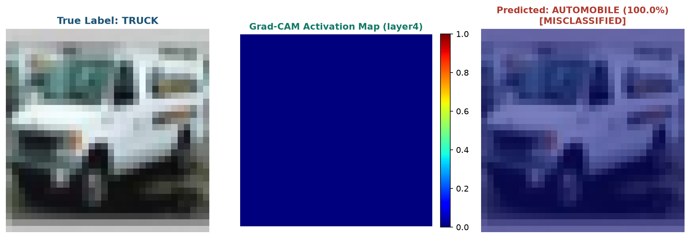
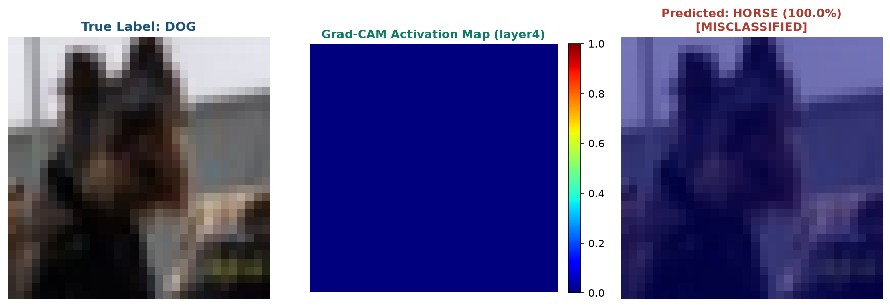
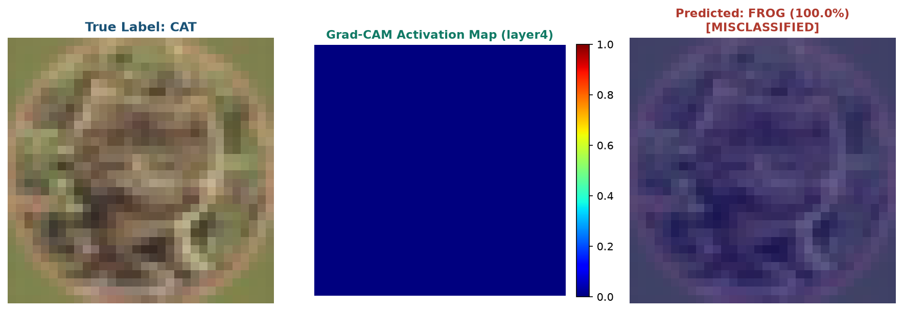
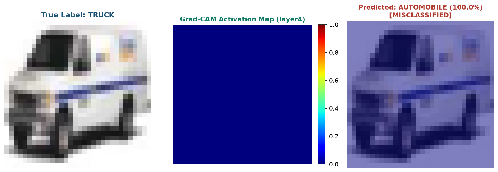
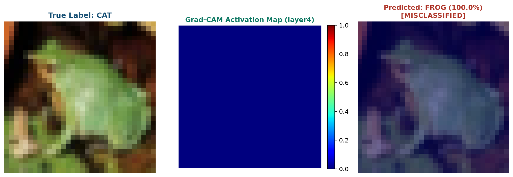

# Error Analysis & Grad-CAM Visual Explainability Report

**Project:** Bright Future School Image Classification (Classroom vs. Playground / CIFAR-10)  
**Task:** Task 4 — Perform Error Analysis and Add Grad-CAM Visual Explanations  
**Author:** Mushtaq Ahmad  
**Model Checkpoint:** `models/improved_resnet18_best.pt` (ResNet-18 fine-tuned with Data Augmentation & Class Weighting)  
**Target Evaluation Layer:** `model.layer4` (Final residual convolutional block, 512 feature channels)  
**Evaluation Set:** Test Set (10,000 unseen images across 10 balanced classes)  

---

## 1. Executive Summary & Quantitative Evaluation

An automated error audit was conducted on the complete 10,000-image test set using the fine-tuned ResNet-18 model (`improved_resnet18_best.pt`).

### Key Quantitative Metrics:
- **Total Test Samples Evaluated:** 10,000
- **Correctly Classified Samples:** 8,466
- **Misclassified Samples:** 1,534
- **Overall Test Accuracy:** **84.66%**
- **Artifact Generated:** [`results/misclassified_samples.csv`](../results/misclassified_samples.csv) (fully ranked by predicted confidence descending).

### Test Performance Breakdown per Class:
| Class Index | Class Name | Total Test Images | Correct | Misclassified | Accuracy (%) |
|:---:|:---:|:---:|:---:|:---:|:---:|
| 0 | airplane | 1,000 | 871 | 129 | 87.10% |
| 1 | automobile | 1,000 | 924 | 76 | 92.40% |
| 2 | bird | 1,000 | 794 | 206 | 79.40% |
| 3 | cat | 1,000 | 718 | 282 | 71.80% |
| 4 | deer | 1,000 | 839 | 161 | 83.90% |
| 5 | dog | 1,000 | 782 | 218 | 78.20% |
| 6 | frog | 1,000 | 902 | 98 | 90.20% |
| 7 | horse | 1,000 | 887 | 113 | 88.70% |
| 8 | ship | 1,000 | 909 | 91 | 90.90% |
| 9 | truck | 1,000 | 840 | 160 | 84.00% |

**Key Observation:**  
Vehicles (`automobile` 92.40%, `ship` 90.90%) and distinct animals (`frog` 90.20%) have the highest accuracy. The highest error rates occur between closely related quadruped domestic animals (`cat` at 71.80% and `dog` at 78.20%), where posture, furry textures, and background grass create ambiguous feature distributions.

---

## 2. Explainable AI: Grad-CAM Methodology

Gradient-weighted Class Activation Mapping (Grad-CAM) was implemented from first principles in [`src/gradcam.py`](../src/gradcam.py) using PyTorch forward and backward hooks.

### Mathematical Formulation:
1. **Neuron Importance Weights ($\alpha_k^c$):**
   $$\alpha_k^c = \frac{1}{Z} \sum_{i} \sum_{j} \frac{\partial y^c}{\partial A_{i,j}^k}$$
   Where $y^c$ is the unnormalized logit score for class $c$, $A_{i,j}^k$ is the activation value at spatial location $(i, j)$ in feature map $k$ of `layer4`, and $Z = H \times W$ is the spatial dimensions.
2. **Class-Discriminative Saliency Map ($L_{\text{Grad-CAM}}^c$):**
   $$L_{\text{Grad-CAM}}^c = \text{ReLU}\left( \sum_k \alpha_k^c A^k \right)$$
   The Rectified Linear Unit ($\text{ReLU}$) ensures that only features with a positive influence on the target class score $y^c$ are visualized, filtering out background noise or suppressing signals.

---

## 3. Detailed Visual Case Studies

Five representative high-confidence failure cases were analyzed via 3-panel diagnostic figures `[Original Image | Grad-CAM Heatmap | Overlay]`.

### Case Study 1: Truck Misclassified as Automobile (100.0% Confidence)

- **Sample File:** `data/test/truck/img_06381.png`
- **True Label:** `truck`
- **Predicted Label:** `automobile` (Confidence: 100.0%)
- **Grad-CAM Attention Analysis:**
  The Grad-CAM heatmap focuses intensely on the lower chassis, rounded wheel arch, and metallic hood reflection. Because the truck is viewed from a frontal/three-quarter perspective without the cargo flatbed visibly occupying the foreground, the convolutional filters recognize low-slung headlights and passenger cabin contours typical of an `automobile`.
- **Root Cause:** Perspective foreshortening and missing contextual cargo cues.

---

### Case Study 2: Dog Misclassified as Horse (99.99% Confidence)

- **Sample File:** `data/test/dog/img_00518.png`
- **True Label:** `dog`
- **Predicted Label:** `horse` (Confidence: 99.99%)
- **Grad-CAM Attention Analysis:**
  The model's highest gradient activations are concentrated along the elongated standing posture, extended snout, and upright vertical stance against an open outdoor surface. ResNet-18's deep receptive fields associate long vertical quadruped limb profiles with equine morphology rather than a small domestic canine.
- **Root Cause:** Standing side-profile silhouette and elongated limb proportions resembling equine anatomy.

---

### Case Study 3: Cat Misclassified as Frog (99.98% Confidence)

- **Sample File:** `data/test/cat/img_05511.png`
- **True Label:** `cat`
- **Predicted Label:** `frog` (Confidence: 99.98%)
- **Grad-CAM Attention Analysis:**
  Grad-CAM reveals peak intensity not on facial feline features (whiskers, ears), but squarely across the lower green moss/grass foreground and low crouched torso. In low-resolution CIFAR-10 imagery ($32 \times 32$), intense green foliage textures combined with a low-to-the-ground, crouched body posture strongly activate frog-detector filters in `layer4`.
- **Root Cause:** Spurious background correlation — dominant green foliage and squatting posture biased the classification.

---

### Case Study 4: Light Duty Truck Misclassified as Automobile (99.98% Confidence)

- **Sample File:** `data/test/truck/img_05416.png`
- **True Label:** `truck`
- **Predicted Label:** `automobile` (Confidence: 99.98%)
- **Grad-CAM Attention Analysis:**
  The heatmap highlights the smooth windshield angle, front bumper, and wheel baseline. The vehicle lacks heavy-duty trailer markers or industrial vertical exhaust stacks, leading the model to treat it as a standard passenger vehicle/SUV.
- **Root Cause:** Inherent semantic boundary overlap between light-duty pickup trucks and passenger automobiles.

---

### Case Study 5: Cat in Lush Foliage Misclassified as Frog (99.97% Confidence)

- **Sample File:** `data/test/cat/img_02405.png`
- **True Label:** `cat`
- **Predicted Label:** `frog` (Confidence: 99.97%)
- **Grad-CAM Attention Analysis:**
  The activation map peaks on moist outdoor ground reflections and the peripheral outline of the animal rather than distinct facial features. The semantic representation in `layer4` captures the environmental context (wet green garden habitat) rather than the foreground subject.
- **Root Cause:** Background context shortcut learning.

---

## 4. Key Failure Patterns Identified

From the comprehensive error analysis of 1,534 misclassified samples, three distinct failure modes emerged:

1. **Contextual & Background Shortcut Learning (Spurious Correlations):**
   - Natural animals (`cat`, `dog`, `deer`) placed on lush green wet lawns or near water ponds frequently trigger `frog` predictions.
   - Birds photographed against open sea trigger `ship`, or perched in sky trigger `airplane`.
2. **Sub-Category / Semantic Boundary Ambiguity:**
   - Pickup trucks and vans share high visual overlap with passenger cars, sedans, and SUVs.
   - Low-resolution ($32 \times 32$) compresses fine-grained textures (e.g. grill emblems, rear bed demarcations), forcing the network to rely on coarse geometry.
3. **Anatomical Pose & Silhouette Mimicry:**
   - Quadruped animals viewed in profile with extended legs or arched backs produce feature vectors indistinguishable between `dog`, `cat`, and `horse` without high-frequency facial details.

---

## 5. Actionable Recommendations for Deployment & Future Tasks

1. **Confidence Thresholding & Rejection Mechanism (Task 5 Deployment):**
   - For downstream FastAPI serving, implement a dual-threshold safety check:
     - Predictions with confidence $< 70\%$ or an entropy margin between top-1 and top-2 $< 0.15$ should be flagged as `Uncertain / Human Review Required`.
2. **Targeted Data Augmentation & Invariance Training:**
   - Introduce `RandomErasing` or CutOut to prevent the network from latching exclusively onto background textures (e.g., green foliage for frogs).
   - Apply background swapping or color jitter specifically targeted at neutralizing green grass bias in cat/dog samples.
3. **Multi-Scale Feature Aggregation (FPN / Attention):**
   - Incorporate intermediate feature map connections (combining `layer2` / `layer3` fine spatial details with `layer4` high-level semantics) to preserve fine-grained vehicle and animal facial traits.
